# 🚀 Awesome AI Code Review & Static Analysis (SAST)

  

  
  
  
  
  
  

---

## 🌟 Top AI Code Review, Static Analysis (SAST) & Linters Ecosystem

> ⚡ **A curated directory of top-tier SaaS platforms and production-grade open-source tools** dedicated to automated pull request (PR) reviews, static application security testing (SAST), AST-driven linters, secret detection, and LLM-assisted vulnerability remediation.

🔍 **SEO Keywords**: `ai code review`, `sast tools`, `static analysis`, `pull request review agent`, `code quality`, `application security`, `devsecops`, `llm code review`, `secret scanner`, `iac security`.

---

## 📑 Table of Contents

- [📊 Sector Overview & Market Dynamics](#-sector-overview--market-dynamics)
- [☁️ SaaS / Hosted Platforms](#️-saas--hosted-platforms)
- [🔓 Open-Source GitHub Projects](#-open-source-github-projects)
- [⭐ Star History](#-star-history)
- [💖 Support & Sponsorship](#-support--sponsorship)
- [🤝 How to Contribute](#-how-to-contribute)
- [⚖️ Disclaimer](#️-disclaimer)

---

## 📊 Sector Overview & Market Dynamics

The global Static Application Security Testing (SAST) and automated code review market is estimated at **$2.5B–$4.2B**, expanding rapidly at a **~18–22% CAGR** driven by DevSecOps shift-left adoption and the explosive proliferation of AI-generated code. The sector exhibits a **moderately fragmented and evolving structure**: multi-product enterprise AppSec giants dominate traditional compliance-heavy portfolios, while agile developer-first AI code review and next-gen Rust-powered SAST platforms rapidly capture day-to-day developer workflows.

---

## ☁️ SaaS / Hosted Platforms

*A comprehensive benchmark of commercial AI code reviewers, cloud static analysis, and enterprise AppSec suites sorted by company valuation / revenue.*

| Platform | Company Size (Valuation / Revenue) | Pricing (Starting Paid Tier) | Free Tier / Free Trial Limits | Key Highlights |
| :--- | :--- | :--- | :--- | :--- |
| **[Snyk Code](https://snyk.io)** | **~$7.4B** valuation (~$309M ARR) | $25 / developer / month (Team plan) | **Free Forever**: 100 tests/month for Snyk Code (SAST); unlimited members; 60-day inactivity expiration | Developer-first cloud SAST platform powered by DeepCode AI providing real-time IDE and PR vulnerability detection with automated fix recommendations. |
| **[SonarQube Cloud](https://sonarsource.com)** | **~$4.7B** valuation (~$200M ARR) | $34 / month (100k Lines of Code) | **Free Forever**: Up to 50,000 LOC for private repositories; unlimited LOC for public open-source repositories | Cloud-based continuous code quality and static analysis service supporting 30+ languages with AI CodeFix suggestions, PR decoration, and security hotspots. |
| **[Veracode Static Analysis](https://veracode.com)** | **~$2.5B** valuation (~$280M ARR) | ~$15,000 / year (starts ~$1,250/mo base app tier) | **Free Trial Only**: Custom sales-scoped Proof of Concept (PoC) / 14-day trial for select modules | Enterprise cloud AppSec platform offering binary and source-level SAST, Veracode Fix AI remediation, and compliance reporting across CI/CD pipelines. |
| **[Black Duck Coverity](https://blackduck.com)** | **~$2.1B** acquisition (~$500M ARR) | ~$15,000 / year (~$800–$1,500/dev/yr base tier) | **Free Forever (OSS only)**: Coverity Scan is free for registered open-source projects; commercial SAST is sales-assisted PoC evaluation (14–30 days) | Industrial-grade static analysis engine renowned for deep path-sensitive defect and security vulnerability detection in C/C++, Java, C#, and embedded codebases. |
| **[CodeRabbit](https://coderabbit.ai)** | **~$1.5B** valuation (~$100M ARR) | $24 / developer / month (billed annually) or $30/mo | **Free Tier & 14-Day Trial**: Free plan offers PR summaries; 14-day full free trial of Advanced plan; free Team features for public open-source repos | AI-first pull request review platform delivering line-by-line code walkthroughs, sequence diagrams, AST-verified bug detection, and one-click commit fixes across GitHub and GitLab. |
| **[Checkmarx One](https://checkmarx.com)** | **~$1.15B+** valuation (~$200M ARR) | ~$30,000 / year (~$1,000/dev/yr base SAST tier) | **Free Trial Only**: 14-day sales-guided Proof of Concept (PoC) evaluation; 30-day trial for local developer assist | Cloud-native enterprise application security platform unifying SAST, SCA, IaC security, and AI-guided remediation for complex software portfolios. |
| **[Semgrep Cloud Platform](https://semgrep.dev)** | **~$600M** valuation (~$25M ARR) | $30 / contributor / month (Team plan) | **Free Forever**: Up to 10 contributors, 10 repositories, and 60 AI credits/month; unlimited scans for open source | Managed AppSec platform combining fast syntax-aware static analysis rules with Semgrep Assistant AI for false-positive triage and contextual remediation guidance. |
| **[CAST Highlight](https://castsoftware.com)** | **~$150M** valuation (~$50M ARR) | ~$6,800 / application / year (~$567/mo base tier) | **Free Trial Only**: Guided sandbox workshops & partner assessments; no permanent self-serve free plan | Enterprise software intelligence and maintainability analytics platform measuring technical debt, cloud-readiness, architectural complexity, and engineering velocity. |
| **[Codacy](https://codacy.com)** | **~$70M** valuation (~$8M ARR) | $18 / developer / month (billed annually) or $21/mo | **Free Forever & 14-Day Trial**: Free developer plan for local IDE plugins & unlimited public repos; 14-day free trial of Team tier | Automated cloud code review and quality governance platform aggregating static analysis, security scanning, test coverage, and AI-assisted PR insights. |
| **[DeepSource](https://deepsource.com)** | **~$25M** valuation (~$3M ARR) | $24 / user / month (billed annually) or $30/mo | **Free Forever**: Up to 3 team members, 3 private repositories, and 1,000 PR reviews/month for public open source | Cloud static analysis and code health platform featuring Autofix AI, continuous vulnerability scanning, and automated quality gates for pull requests. |
| **[Code Climate (Qlty Cloud)](https://castsoftware.com)** | **~$20M** valuation (~$5M ARR) | $20 / contributor / month (Qlty Pro plan) | **Free Forever**: 1,000 analysis minutes/month and 100 AI autofixes/month across unlimited public/private repos | Code quality maintainability, duplication checks, automated linting, and AI autofix suggestions (via Qlty Software, spun out from Code Climate). |

---

## 🔓 Open-Source GitHub Projects

*Open-source static analysis engines, AI PR reviewers, vulnerability linters, and code quality tools — **sorted strictly by GitHub stargazers (descending)**. Every project badge links directly to its live stargazers page.*

1. **[Ruff](https://github.com/astral-sh/ruff)** (`astral-sh/ruff`)   
   ⚡ Extremely fast Python linter and code formatter written in Rust. Replaces Flake8, Bandit, isort, pydocstyle, and pyupgrade at 10–100x speed.

2. **[LLVM / Clang Static Analyzer](https://github.com/llvm/llvm-project)** (`llvm/llvm-project`)   
   🛡️ Foundational compiler infrastructure and industrial static analysis framework (`clang --analyze` / Clang-Tidy) discovering memory leaks, undefined behavior, and security vulnerabilities in C, C++, and Objective-C.

3. **[ShellCheck](https://github.com/koalaman/shellcheck)** (`koalaman/shellcheck`)   
   🐚 Static analysis tool for shell scripts (Bash, Sh, Dash, Ksh) providing warnings and suggestions regarding syntax errors, subtle bugs, and unsafe parameter expansions.

4. **[Trivy](https://github.com/aquasecurity/trivy)** (`aquasecurity/trivy`)   
   🔍 Comprehensive all-in-one security scanner detecting known CVEs, IaC misconfigurations, hardcoded secrets, software licenses, and SBOM risks across repositories, container images, and Kubernetes clusters.

5. **[Gitleaks](https://github.com/gitleaks/gitleaks)** (`gitleaks/gitleaks`)   
   🔑 High-performance SAST secret scanner written in Go designed to detect API keys, tokens, passwords, and sensitive credentials in Git repositories and CI/CD pipelines.

6. **[TruffleHog](https://github.com/trufflesecurity/trufflehog)** (`trufflesecurity/trufflehog`)   
   🐽 Deep scanner that finds exposed secrets and high-entropy strings across entire Git histories, filesystem paths, and S3 buckets with active credential verification.

7. **[ESLint](https://github.com/eslint/eslint)** (`eslint/eslint`)   
   🌐 The quintessential pluggable static analysis and linting utility for JavaScript and TypeScript codebases.

8. **[Biome](https://github.com/biomejs/biome)** (`biomejs/biome`)   
   ⚡ Fast formatter and linter for JavaScript, TypeScript, JSX, and CSS built from scratch in Rust with unified diagnostics.

9. **[Oxlint](https://github.com/oxc-project/oxc)** (`oxc-project/oxc`)   
   🚀 Blazing fast JS/TS linter written in Rust designed to run 50–100x faster than traditional JS linters, outputting zero-config diagnostics.

10. **[Semgrep](https://github.com/semgrep/semgrep)** (`semgrep/semgrep`)   
    🔎 Fast, syntax-aware static analysis engine supporting 30+ languages. Uses lightweight pattern-matching that mirrors target language syntax for custom security and compliance rules.

11. **[ast-grep](https://github.com/ast-grep/ast-grep)** (`ast-grep/ast-grep`)   
    🌳 CLI tool for code structural search, linting, and AST-based rewriting across multiple programming languages using Tree-sitter.

12. **[PR-Agent / Qodo Merge](https://github.com/qodo-ai/pr-agent)** (`qodo-ai/pr-agent`)   
    🤖 AI-powered pull request reviewer providing automated PR summaries, line-level code reviews, vulnerability checks, and `/improve` suggestions for GitHub, GitLab, and Bitbucket.

13. **[Infer](https://github.com/facebook/infer)** (`facebook/infer`)   
    🔬 Advanced static analyzer developed by Meta for Java, C, C++, and Objective-C that proves the absence of null pointer exceptions, resource leaks, and concurrency race conditions.

14. **[Hadolint](https://github.com/hadolint/hadolint)** (`hadolint/hadolint`)   
    🐳 Smarter Dockerfile linter that parses the Dockerfile into an AST and evaluates rules against best Docker practices and ShellCheck checks.

15. **[SonarQube Community Build](https://github.com/SonarSource/sonarqube)** (`SonarSource/sonarqube`)   
    🏰 Widely adopted open-source static code inspection platform measuring code maintainability, test coverage, architectural smells, and security bugs across 30+ languages.

16. **[GitHub CodeQL](https://github.com/github/codeql)** (`github/codeql`)   
    🧬 Semantic code analysis engine that compiles source code into a queryable relational database to uncover zero-days, tainted dataflows, and complex vulnerabilities.

17. **[SQLFluff](https://github.com/sqlfluff/sqlfluff)** (`sqlfluff/sqlfluff`)   
    💾 Dialect-flexible and configurable SQL linter and auto-formatter designed for modern ELT and analytics engineering pipelines.

18. **[Reviewdog](https://github.com/reviewdog/reviewdog)** (`reviewdog/reviewdog`)   
    🐶 Automated code review bridge that integrates outputs from any arbitrary linter or SAST tool into inline GitHub/GitLab pull request comments.

19. **[Checkov](https://github.com/bridgecrewio/checkov)** (`bridgecrewio/checkov`)   
    🏗️ Static analysis scanner for Infrastructure as Code (IaC) supporting Terraform, CloudFormation, Kubernetes, Helm, ARM, and serverless frameworks.

20. **[Gosec](https://github.com/securego/gosec)** (`securego/gosec`)   
    🐹 Security vulnerability checker that inspects Go abstract syntax trees (AST) for SQL injections, weak crypto, path traversal, and memory mismanagement.

21. **[Bandit](https://github.com/PyCQA/bandit)** (`PyCQA/bandit`)   
    🐍 Dedicated Python AST-based static analyzer engineered by PyCQA to detect common security flaws, injection vectors, and weak cipher suites.

22. **[Brakeman](https://github.com/presidentbeef/brakeman)** (`presidentbeef/brakeman`)   
    🛤️ Static analysis security scanner tailored exclusively for Ruby on Rails applications, scanning code structure without requiring database or runtime dependencies.

23. **[Error Prone](https://github.com/google/error-prone)** (`google/error-prone`)   
    ☕ Compile-time static analysis tool for Java developed by Google that catches common programming mistakes at build time as compiler errors.

24. **[Cppcheck](https://github.com/danmar/cppcheck)** (`danmar/cppcheck`)   
    ⚙️ Static analysis tool for C/C++ dedicated to finding real bugs, undefined behaviors, pointer misuses, and memory leaks with minimal false positives.

25. **[TFLint](https://github.com/terraform-linters/tflint)** (`terraform-linters/tflint`)   
    🧱 Pluggable Terraform linter that verifies provider-specific configurations, deprecated syntax, and cloud provider resource rules.

26. **[PMD](https://github.com/pmd/pmd)** (`pmd/pmd`)   
    ☕ Extensible multi-language static code analyzer for Java, Apex, PLSQL, and XML catching unused variables, empty catch blocks, and duplicated code (CPD).

27. **[ChatGPT-CodeReview](https://github.com/anc95/ChatGPT-CodeReview)** (`anc95/ChatGPT-CodeReview`)   
    💬 Open-source GitHub Action utilizing OpenAI models to automatically review Git diffs and post review comments on pull requests.

28. **[Actionlint](https://github.com/rhysd/actionlint)** (`rhysd/actionlint`)   
    ⚡ Static checker for GitHub Actions workflow files detecting invalid expressions, unknown actions, and syntax errors before pushing commits.

29. **[SpotBugs](https://github.com/spotbugs/spotbugs)** (`spotbugs/spotbugs`)   
    🐞 The spiritual successor to FindBugs for Java and JVM bytecodes searching for 400+ bug patterns like null pointer dereferences and infinite loops.

30. **[Joern](https://github.com/joernio/joern)** (`joernio/joern`)   
    🕸️ Open-source Code Property Graph (CPG) platform providing interprocedural AST, CFG, and CDG query capabilities to uncover deep security vulnerabilities.

31. **[Opengrep](https://github.com/opengrep/opengrep)** (`opengrep/opengrep`)   
    🔓 Fast, open-source static analysis engine fork of Semgrep dedicated to preserving open-source cross-file taint analysis, deep rules, and community governance.

32. **[Bearer](https://github.com/Bearer/bearer)** (`Bearer/bearer`)   
    🛡️ Static code security scanner tailored for discovering data leaks, OWASP vulnerabilities, sensitive data privacy risks, and compliance posture.

33. **[Semantic Code Search](https://github.com/sturdy-dev/semantic-code-search)** (`sturdy-dev/semantic-code-search`)   
    🔎 Semantic code analysis and vector search indexing engine across large code repositories.

34. **[Code Review Agent (cra)](https://github.com/VictorKildahl/cra)** (`VictorKildahl/cra`)   
    🤖 Agentic CLI tool built to inspect Git diffs, evaluate architectural consistency, and generate actionable code review feedback locally or in CI pipelines.

---

## ⭐ Star History

---

## 💖 Support & Sponsorship

Thank you for exploring this curated ecosystem! If you find this list valuable for your DevSecOps pipelines, engineering workflows, or security auditing, please consider supporting the project:

- ⭐ **Star this repository** to help others discover it!
- 🍴 **Fork and share** with your developer community and team.
- ☕ **Buy me a coffee / Sponsor development**: Support ongoing curation, tooling benchmarks, and open-source maintenance via the [GitHub Sponsor Dashboard](https://github.com/sponsors/ishandutta2007).

---

## 🤝 How to Contribute

Contributions are warmly welcomed! To suggest a new tool, update pricing models, or report outdated entries:

1. Fork this repository.
2. Create a new branch: `git checkout -b feature/add-new-tool`.
3. Add the SaaS platform or open-source repository ensuring factual accuracy and direct URLs.
4. Open a Pull Request with a short summary of the addition.

---

## ⚖️ Disclaimer

*All product names, logos, brands, and registered trademarks belong to their respective owners. Mention of SaaS platforms or open-source projects does not imply endorsement or affiliation. Pricing and limits reflect publicly available vendor data and are subject to change.*
